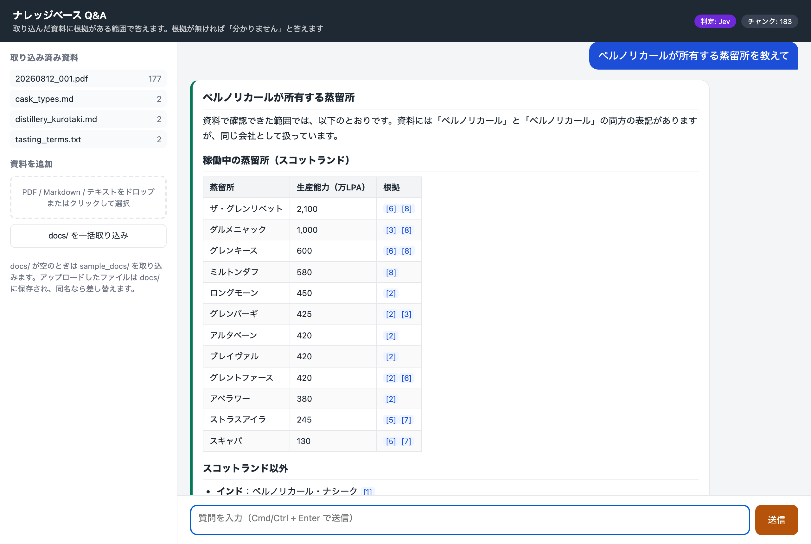
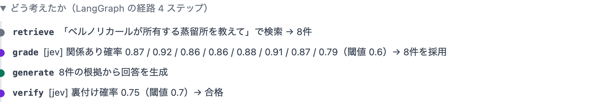
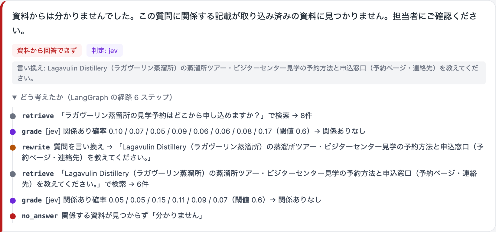
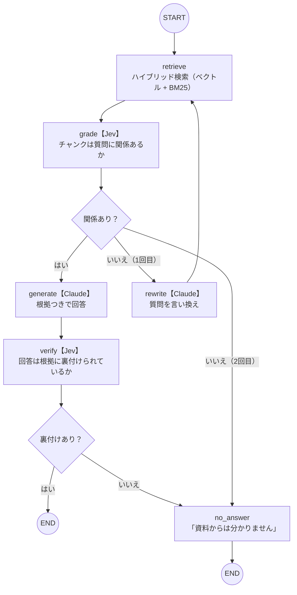

# ナレッジベース Q&A（RAG）— 資料を根拠に、出典を示して答える

手元の資料（PDF / Markdown / テキスト）を取り込み、チャットで質問すると
**資料に根拠がある範囲だけ答え、根拠の箇所（ファイル名・ページ・抜粋）を一緒に示す。**
根拠が見つからなければ「資料からは分かりません」と答える。

資料は `docs/` に置くだけで差し替えられ、分野を問わない（社内規程・製品マニュアル・専門書のメモなど）。
お試し用に架空のウイスキーのメモを 3 本同梱している。

LangChain / LangGraph / Claude API / Jev（TypeSafe AI・任意）/ FastEmbed / Chroma / FastAPI で構成。

## デモ

実際の資料（OCR したスキャン PDF、約 50 ページ）に質問した様子。判定は Jev、生成は Claude。

**一覧を問う質問に、根拠番号つきの表で答える**



**どう考えたか（LangGraph の経路と判定値）**



**資料に無いことは、言い換えて再検索したうえで「分かりません」と答える**



## 動かし方

必要なもの: Docker、Claude API キー（[Anthropic Console](https://console.anthropic.com/)）

```bash
git clone https://github.com/tmaeda1981jp/knowledge-base-qa.git
cd knowledge-base-qa
cp .env.example .env            # ANTHROPIC_API_KEY を書き込む
docker compose up --build -d    # 初回はビルドに数分
docker compose run --rm app python -m app.ingest   # 同梱サンプルを取り込み
```

ブラウザで http://localhost:8000 を開き、画面のサンプル質問を押すか、質問を入力して **Cmd/Ctrl + Enter** で送信する。

- 初回の取り込みは埋め込みモデル（約 220MB）のダウンロードが入るため 1〜2 分かかる。2 回目以降はすぐ終わる
- `make up` / `make ingest` / `make down` でも同じ操作ができる
- `.env` を変更したあとは `docker compose up -d --force-recreate` で反映する（`restart` では反映されない）

## Jev（判断特化モデル）を使う

既定では、検索結果の関係判定と回答の裏付け検証も Claude が行う。
TypeSafe AI の [Jev](https://docs.typesafe.ai) を使うと、この 2 つの判定が数百ミリ秒・ほぼ無料になり、確率値で閾値調整ができる。

1. [TypeSafe のコンソール](https://docs.typesafe.ai) で API キーを発行する
2. `.env` の `TYPESAFE_API_KEY=` にキーを書く
3. `docker compose up -d --force-recreate` で再起動する
4. 画面右上のバッジが「判定: Jev」になっていれば有効。回答ごとの「どう考えたか」にも `[jev]` と表示される

Jev 側でエラーが起きたときは自動で Claude の判定に切り替わり、経路に `claude (fallback)` と表示される。
キーを外せば Claude だけの構成に戻る。

## 自分の資料で使う

1. PDF / Markdown / テキストを `docs/` に置く（`docs/` は Git 管理外なので、資料がリポジトリに入ることはない）
2. `docker compose run --rm app python -m app.ingest` を実行する。画面左の「docs/ を一括取り込み」ボタンでも同じ
3. 画面左の「資料を追加」にファイルをドロップすると、`docs/` に保存して即取り込む

- スキャンした PDF は、スキャナー側で OCR（テキスト認識）をかけたものを置く。画像だけの PDF は文字を取り出せず警告が出る
- 同じファイル名を取り込み直すと、古い内容を消して差し替える
- 著作権の都合で、デモに使った実際の資料は同梱していない

### 取り込んだデータをリセットする

取り込んだ内容はすべて `data/chroma/` に入っている。サンプルから自分の資料に切り替えるときなど、まっさらにしたい場合は次を実行する。

```bash
docker compose down        # 起動中なら止める
rm -rf data/chroma         # ベクトルDBを削除（make reset でも同じ）
docker compose up -d
docker compose run --rm app python -m app.ingest   # 取り込み直し
```

`data/fastembed_cache/`（埋め込みモデルのキャッシュ）は残して構わない。消すと次回の取り込みで再ダウンロードが発生する。

## 環境変数

| 変数 | 既定 | 説明 |
|---|---|---|
| `ANTHROPIC_API_KEY` | （必須） | Claude API キー |
| `ANTHROPIC_MODEL` | `claude-opus-5-5` | 言い換え・回答生成に使うモデル。コスト重視なら `claude-sonnet-5-5` |
| `TYPESAFE_API_KEY` | （空） | 設定すると判定に Jev を使用 |
| `JEV_MODEL` | `jev-latest` | Jev のモデル |
| `GRADE_THRESHOLD` | `0.6` | チャンクを「関係あり」とみなす確率の下限 |
| `VERIFY_THRESHOLD` | `0.7` | 回答を「裏付けあり」とみなす確率の下限 |
| `VERIFY_ENABLED` | `true` | `false` で裏付け検証をスキップ |
| `RETRIEVE_K` | `8` | 検索で取得するチャンク数 |
| `EXPAND_TO_PAGE` | `true` | 取得チャンクを同じページ全体に広げてから判定・回答に渡す |
| `EMBEDDING_MODEL` | `paraphrase-multilingual-MiniLM-L12-v2` | FastEmbed の埋め込みモデル（ローカル実行・キー不要） |
| `CHUNK_SIZE` / `CHUNK_OVERLAP` | `400` / `80` | チャンク分割（字数） |

## 仕組み



設計の判断理由や実資料での較正の経緯は [`design/plan.html`](design/plan.html) にまとめている。

### キーワード検索の分割方式について

検索はベクトル検索（意味）と BM25（文字の一致）を組み合わせている。BM25 側の日本語の分割は、形態素解析ではなく**文字 2-gram**（2 文字ずつの組）にした。

- 今回の題材（ウイスキーの資料）は蒸留所名・会社名などの固有名詞が多く、辞書に無い語や OCR の誤認識（「ペルノ」→「ベルノ」）が頻発した。2-gram は辞書に頼らず、語の一部が壊れていても残りで照合できるため、この条件では有利だった
- 一方で、文章主体の資料（社内規程・マニュアルなど）では、形態素解析のほうが単語の境界が正しく、「東京都」が「京都」に当たるような偽の一致も起きない。活用形の正規化も効く

資料の性質によって最適解が変わる部分である。分割処理は `app/retriever.py` の `tokenize()` に閉じているので、Janome や Sudachi などの形態素解析器に差し替えたり、形態素と 2-gram を併用したりする実験が簡単にできる。

## 開発

```bash
uv sync                                   # Python 3.12 / uv が必要
uv run python -m app.ingest               # 取り込み
uv run uvicorn app.main:app --reload      # http://localhost:8000
uv run pytest                             # テスト（LLM・Jev はモック）
```

| パス | 役割 |
|---|---|
| `app/graph.py` | LangGraph の定義（ノードと分岐） |
| `app/judge.py` | 判定レイヤー（Jev / Claude の切り替えとフォールバック） |
| `app/retriever.py` | ハイブリッド検索（ベクトル + BM25 → ページ展開） |
| `app/prompts.py` | プロンプトと判定指示（日本語） |
| `app/main.py` | FastAPI（API と画面の配信） |
| `static/index.html` | チャット画面 |
| `tests/` | 分岐・検索・API のテスト |
